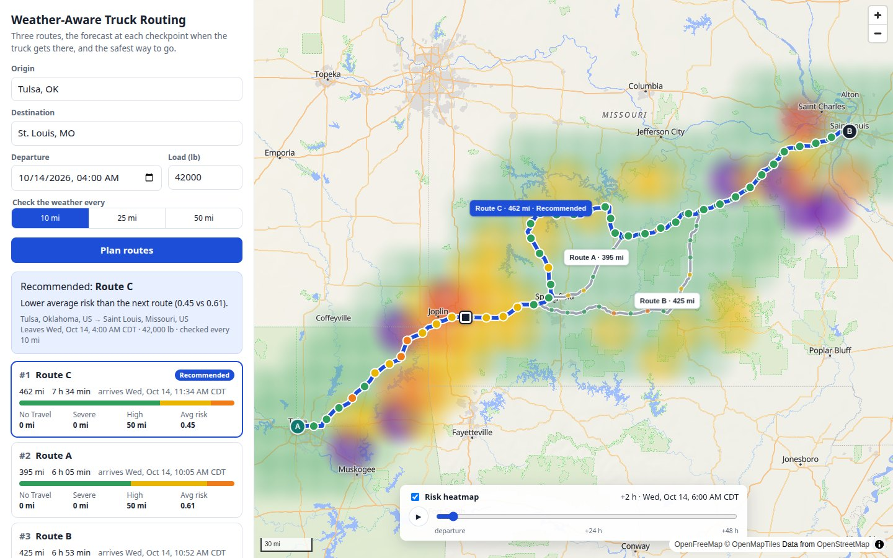
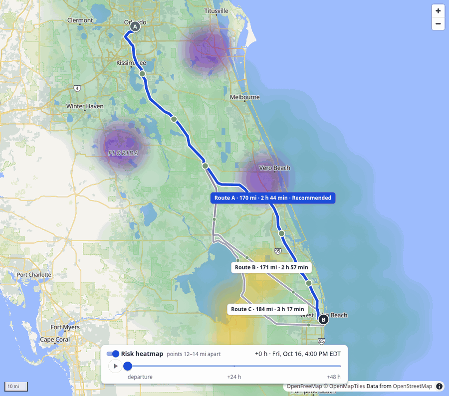

# Weather-Aware Truck Routing

[](https://github.com/muhammadsamad99/weather-aware-truck-routing/actions/workflows/ci.yml)

**Live demo:** https://weather-aware-truck-routing-nl1o.onrender.com — a free Render instance, so it
sleeps when idle; the first request after a pause takes about a minute.

Helps a truck driver choose the safest route for a trip. Enter the origin, destination, departure time and
load. The app finds three routes and checks the forecast at checkpoints every 10, 25 or 50 miles, for the
hour the truck will be at each one. It rates each checkpoint on the risk table, adjusted for the load, and
recommends a route with the reason. A heatmap with a 0–48 hour slider shows the weather risk along the
trip corridor.

React + TypeScript + Material UI + MapLibre GL on the front end, Django + Django REST Framework behind it.

**Highlights**

- **Routes for the truck's real weight.** Valhalla's `truck` costing gets the gross weight (an empty
  tractor-trailer plus the load), which decides the roads and bridges the truck may use.
- **Weather for the hour the truck is there.** Each checkpoint gets the rain and snow of the hour it is reached
  in, and wind interpolated between the readings either side of its ETA.
- **The brief's recommendation order, with the reason.** No Travel ranks last; then the fewest Severe miles,
  High miles, average risk and time. When the pick isn't the fastest, the panel says what the extra time buys.
- **A slider with no waiting.** All 49 hourly heatmap frames come with the plan, so moving the slider makes no
  network request.
- **A backup for every outside service.** When a free service fails, a second one takes over; where that changes
  the result (car routes, the backup forecast), the panel says so (see [Backups](#backups)). When both fail, the
  message says in plain words what failed and what to do.





## Using it

1. **Enter the trip:**
   - Origin and destination. Pick a suggestion, or type a place or `lat, lon`.
   - Departure (your local time), load in pounds, and how often to check the weather.
2. **Read the result.** The panel names the recommended route and why it was chosen. Each route has a card
   with:
   - distance, driving time and arrival;
   - miles at each risk level, as a bar;
   - No Travel, Severe and High miles;
   - the average risk.

   When the recommended route isn't the fastest, the panel also says how much longer it takes and what that
   buys.

   Click a card, or a route on the map, to select it. The table below the cards lists the selected route's
   checkpoints with their arrival times, forecast and risk. Click a row to find that checkpoint on the map;
   from the keyboard, the table is one Tab stop, the arrow keys move between rows and Enter finds the row.
3. **On the map:**
   - Each route has a tag with its distance and driving time.
   - Every checkpoint is coloured by its risk; hover one for its arrival time, click it for the details.
   - The slider moves the heatmap through the next 48 hours from departure; ▶ plays it.
   - The dark square marks where the truck is, on the selected route, at the slider's hour.

## How the brief is covered

| The brief asks for | Where it is | Tests |
|---|---|---|
| Origin, destination, departure date/time, load | `TripForm`, `PlaceInput` → `POST /api/plan`, validated in `planner/serializers.py` | — |
| 3 route options from a routing API | `planner/providers/valhalla.py` | — |
| Weather every 10/25/50 mi at the truck's ETA | `planner/checkpoints.py`, `planner/weather.py` | `test_checkpoints.py` (spacing and ETAs) |
| The risk table and load rules | `planner/risk.py` | `test_risk.py`, `test_legend.py` |
| A recommendation that balances risk and time, in the brief's order | `planner/recommend.py` (the order, the reason, the trade-off line) | `test_recommend.py` |
| Routes, checkpoints, risk levels, ETAs and route summaries on a map | `MapView.tsx` (route lines and tags, coloured checkpoints, hover and popups), `RouteCards.tsx` | — |
| A heatmap along the corridor with a 0–48 h slider | `planner/heatmap.py`, `service._heatmap`, `HeatmapControl.tsx` | — |

## How a plan is made

| Step | What happens | Code |
|---|---|---|
| Places | Typed places are looked up with [Photon](https://photon.komoot.io) (OpenStreetMap). For a name without digits, towns and cities rank above landmarks: Photon puts a university first for "St. Louis, MO". If Photon fails while a trip is being planned, the place is looked up with [Nominatim](https://nominatim.org) (OpenStreetMap) instead. `lat, lon` needs no lookup. | `planner/geocode.py` |
| Routes | See [Routes](#routes) below. | `planner/providers/valhalla.py` |
| Checkpoints | At 0, N, 2N, … miles along each route, and at the destination. Each checkpoint's ETA is the departure plus Valhalla's driving time to that point. | `planner/checkpoints.py` |
| Weather at the ETA | See [Weather at each checkpoint's ETA](#weather-at-each-checkpoints-eta) below. | `planner/weather.py` |
| Risk | The worst of the wind (after the load rules), rain and snow levels. See [Risk rules and edge cases](#risk-rules-and-edge-cases). | `planner/risk.py` |
| Route totals | The stretch between two checkpoints takes the **worse** of their two levels, so no stretch is rated safer than either end of it. Average risk is the mile-weighted mean of the stretch levels, from 0 (Low) to 4 (No Travel). | `planner/recommend.py` |
| Recommendation | See [The recommendation](#the-recommendation). | `planner/recommend.py` |
| Heatmap | See [The heatmap](#the-heatmap). | `planner/heatmap.py`, `planner/service.py` |

### Routes

- Valhalla's `truck` costing is used, with the gross weight set to an empty tractor-trailer (35,000 lb)
  plus the load.
- Valhalla returns the best route and its own alternates. When there are fewer than three, more are made
  by routing through a waypoint pushed to one side of the best route's midpoint.
- A candidate is kept only if:
  - under 80% of it is the same road as a route already kept;
  - it takes at most 1.6× the best route's time;
  - it doesn't run back over itself for more than 3 miles.
- A waypoint can land on a side road, so the route would drive up to it and back. Where that happens the
  legs are joined where they part.
- The routes are cached for 6 hours per trip and exact load, because the truck's weight decides which roads
  and bridges it may use.

### Weather at each checkpoint's ETA

The forecast is [Open-Meteo](https://open-meteo.com) hourly data:

- **Wind:** speed at 10 m, in mph.
- **Rain:** `rain` + `showers` (both fall on the road), in inches per hour.
- **Snow:** snowfall, in inches per hour.

Rain and snow at a timestamp are the totals for the hour before it. So a truck at a checkpoint at 10:20
gets rain and snow from the 10:00–11:00 hour, and wind interpolated between the 10:00 and 11:00 readings.

A value the forecast leaves out is never read as calm weather: a checkpoint whose hour has no value can't
be rated, so the plan stops with a message, and a heatmap point without a value is left off the map.

Each checkpoint takes the forecast of the 0.1° cell (about 7 mi) it falls in. A plan asks for at most 450
cells, to stay within the free service's limits (see [Services](#services-and-their-limits)). A long trip
checked every 10 mi needs more, so its grid widens until the plan fits: Los Angeles to New York every 10 mi
is read on a 0.4° grid. The panel says so whenever the grid is wider than 0.1°.

### The recommendation

1. Any route with a No Travel stretch ranks behind every route without one.
2. Then routes are ranked by the brief's order:
   1. fewest Severe miles;
   2. fewest High miles;
   3. lowest average risk;
   4. shortest travel time.

The reason names the first criterion that separates the winner from the runner-up.

### The heatmap

- **The grid:** points every 0.2° within 40 mi of any route. The spacing widens until there are at most 180
  points, so a long trip needs no more forecast data than a short one.
- **The frames:** the risk at every point for each hour from departure to departure + 48 h. The plan
  includes all 49 frames, so the slider needs no network requests.
- **On the map:** each point is drawn as a soft disc in its level's colour, about one grid cell wide.

## Risk rules and edge cases

| Condition | Low | Moderate | High | Severe | No Travel |
|---|---|---|---|---|---|
| Wind | < 25 mph | 25 to < 35 | 35 to < 45 | 45 to < 55 | ≥ 55 mph |
| Rain | < 0.10 in/hr | 0.10 to < 0.25 | 0.25 to < 0.50 | 0.50 to 1.00 | > 1.00 |
| Snow | < 0.5 in/hr | 0.5 to < 1.0 | 1.0 to < 2.0 | 2.0 to 3.0 | > 3.0 |

Load rules, applied to wind:

| Wind | Load | Level |
|---|---|---|
| 45–54 mph | over 30,000 lb | No Travel |
| 35–44 mph | over 40,000 lb | Severe |
| 55 mph or more | any | No Travel |

Decisions where the brief leaves room:

- **Shared edges.** The brief's table repeats some values (rain 0.25 and 0.50, snow 1.0 and 2.0). A shared
  value belongs to the **higher** band, and each band runs from its lower edge up to, but not including,
  the next one.
- **No Travel thresholds.** For rain and snow these are strict, as the table writes them (> 1.00, > 3.0),
  so exactly 1.00 in/hr of rain is Severe. Wind No Travel is inclusive (≥ 55 mph).
- **Values between the table's whole numbers.** The brief writes wind in whole mph (25–34, 35–44) and rain
  and snow in hundredths of an inch. Each forecast reading is rounded to that precision (half up, as the
  panel rounds) before it is rated, so a checkpoint's level always matches the numbers shown next to it:
  34.6 mph reads 35 mph and is High, 0.249 in/hr of rain reads 0.25 and is High, and 1.004 reads 1.00 and is
  Severe. The heatmap is rated the same way.
- **Load reasons.** When the load raises a checkpoint's level, the checkpoint's reasons say so ("load
  42,000 lb").
- **No Travel ranks first.** No Travel is worse than Severe, and the brief treats it as "do not drive". So a
  route that crosses any of it is never recommended over one that does not, even with fewer Severe miles.
- **The order is applied as written, and its cost in time is shown.** The brief asks for a balance of risk
  and time, then gives the order: Severe miles, High miles, average risk, travel time. The app applies that
  order as written rather than inventing its own weighting. Two things keep the balance visible and bounded:
  - Routes that take more than 1.6× the time of Valhalla's best route are never offered.
  - When the recommended route isn't the fastest, the panel says what the extra time buys, for example
    "4 h 02 min longer than Route A, the fastest route, for lower average risk (0.08 vs 0.17)". The driver
    can then pick the faster card.
  - Figures are compared at the precision the panel shows them (whole miles, average risk to two
    decimals, travel time to the minute) and rounded the way the browser rounds them, so a difference too
    small to see never decides the ranking, and a reason never reads "0.16 vs 0.16".
- **Truck weight.** Valhalla is given the gross weight: 35,000 lb tare plus the load.
- **Time zones.** Times are sent in UTC and shown in the browser's time zone.
- **Departure window.** A departure from an hour ago up to 14 days ahead is accepted, which is what the
  forecast covers.

## Services and their limits

Every service is free and needs no API key.

| Service | Used for | Limits |
|---|---|---|
| [Valhalla](https://valhalla.github.io/valhalla/) public server, run by [FOSSGIS](https://www.fossgis.de/) | Truck routes | The [usage policy](https://routing.openstreetmap.de/about.html) allows at most one request per second, with attribution and a "fix the map" link (both in the panel footer). The whole service spaces its requests a second apart, and routes are cached. One request may not span more than 1,500 km, so longer trips are routed in legs and joined. The server is sometimes busy, so a busy or "overloaded" answer is tried twice more, 1.5 s and then 3 s later. |
| [Open-Meteo](https://open-meteo.com) | Hourly forecasts | Free for non-commercial use: 600 calls a minute and 10,000 a day. The terms don't say how a request for many locations counts, but each location seems to count as a call: one coast-to-coast plan of about 1,000 locations hit the per-minute limit on its own. So a plan asks for at most 450 (see above), and the whole service asks for at most 560 in any minute: a plan that would go over waits until the minute frees up (at most a minute). Open-Meteo's own limit message can still appear, for example if the host shares its outgoing address with other apps that use Open-Meteo. A request now and then gets no answer for 20 s although the same request a moment later takes a second or two, so a request that gets no answer, or a 502-504, is asked once more a second later (and counts against the minute again). Forecasts are cached for an hour per cell. |
| [Photon](https://photon.komoot.io) | Place search | Fair use. Results are cached for a day. Suggestion lookups give up after a few seconds and the box falls back to typed text; the plan-time lookup waits longer. |
| [Nominatim](https://nominatim.org), run by the [OpenStreetMap Foundation](https://osmfoundation.org) | The plan's place lookups when Photon fails | The [usage policy](https://operations.osmfoundation.org/policies/nominatim/) allows at most one request per second, asks for caching and an identifying User-Agent, and forbids search-as-you-type. So it is never used for suggestions, the whole service spaces its requests a second apart, and results are cached for a day. |
| [OpenFreeMap](https://openfreemap.org) | Base map | None stated. If the base map style cannot load, the routes and weather still draw on a plain background. |
| [MET Norway](https://api.met.no) Locationforecast | Hourly forecasts when Open-Meteo fails | The [terms](https://api.met.no/doc/TermsOfService): an identifying User-Agent, at most 20 requests a second from the whole app, coordinates with at most 4 decimals, no repeat before the answer's `Expires` time, and CC BY 4.0 attribution (in the panel footer). One location per request, so the whole service spaces its requests 0.1 s apart and the backup reads the forecast on at most 150 cells. Answers are cached for an hour, or until `Expires` if later. |
| [OSRM](https://project-osrm.org) demo server | Routes when Valhalla fails | [At most one request per second](https://github.com/Project-OSRM/osrm-backend/wiki/Demo-server), reasonable non-commercial use, no guarantee of uptime. The whole service spaces its requests a second apart. |
| [Open-Meteo geocoding](https://open-meteo.com/en/docs/geocoding-api) | Place suggestions when Photon fails | Free for non-commercial use, like the forecasts. Towns, cities and postcodes; no street addresses. Results are cached for a day. |

Each service's URL can be changed by an environment variable (see `.env.example`), for example to point at
a self-hosted Valhalla.

**Adding a routing provider.** Routing sits behind a small interface (`planner/providers/base.py`): a provider
has a `name` (used in the route cache key and the plan) and a `routes(origin, destination, load_lb, count=3)`
method that returns up to `count` distinct `RouteOption`s, best first, each with its points and cumulative
miles and seconds. Implement one next to `valhalla.py` and select it in `service.make_provider` with
`ROUTING_PROVIDER`; checkpoints, weather, risk and ranking work on `RouteOption`s and don't change.

### Backups

Every outside service has a second one behind it, used only when the first fails (an error, a timeout, a
refusal or a limit, not "nothing found", which is an answer). Where a backup changes the result, the panel
says so. When the backup fails too, the message is the first service's.

| When this fails | This takes over | What changes for the user |
|---|---|---|
| Open-Meteo (forecasts) | MET Norway | The panel says the forecast is the backup's. MET Norway has no snowfall figure, so precipitation whose symbol says snow counts as snow, at Open-Meteo's own ratio (7 cm of snow for 10 mm of water); the data is converted from m/s and mm. Its hourly forecasts reach about two and a half days ahead: a trip that runs past them gets a message saying so, and heatmap hours past them are left off the map. |
| Valhalla (truck routes) | OSRM | A warning in the panel: the routes follow car roads and car driving times, and the truck's weight isn't considered. OSRM often returns two routes rather than three. |
| Photon (suggestions) | Open-Meteo geocoding | Suggestions list towns, cities and postcodes, without street addresses. |
| Photon (a plan's typed places) | Nominatim | Nothing visible. |
| OpenFreeMap (base map) | A plain background | The routes, checkpoints and heatmap still draw. |

A backup lowers the chance that one service takes the app down; it can't rule it out. Two services can fail at
the same time, and on a shared host (see [Known limitations](#known-limitations)) Open-Meteo's geocoding may be
refused along with its forecasts.

## Running it locally

You need Python 3.11 or newer and a current Node LTS. It is tested with Python 3.11.9 and Node 24.21.0, the
versions `render.yaml` and CI pin.

```bash
python3 -m venv .venv && source .venv/bin/activate
pip install -r backend/requirements-dev.txt
DJANGO_DEBUG=1 python backend/manage.py runserver      # the API, on :8000

cd frontend && npm ci && npm run dev                   # the app, on http://localhost:5173
```

The Vite dev server passes `/api` requests to Django.

To run it the way it runs in production, with one server for the app and the API:

```bash
DJANGO_SECRET_KEY=change-me ./build.sh
DJANGO_SECRET_KEY=change-me gunicorn --chdir backend config.wsgi:application --bind 127.0.0.1:8000
```

## Tests and checks

```bash
cd backend && pytest && ruff check .
cd frontend && npm run lint && npx tsc -b
```

CI runs all of these on every push to `main` and on every pull request (`.github/workflows/ci.yml`).

The tests (69, pytest) are kept to the brief's own rules:

- **Checkpoints:** one every 10/25/50 mi plus the destination, on the route itself, with ETAs taken from
  the route's own timing (slow stretches included) rather than an average speed.
- **Risk table:** every edge of the wind, rain and snow bands, every load rule, the worst condition setting
  the level, and the reasons a level names.
- **Ranking:** each step of the recommendation order, a No Travel stretch ranking behind a passable route,
  differences too small to show never deciding, and the reason and trade-off lines.
- **The legend:** the map legend's thresholds are checked against the risk table the backend applies.

## Deploying

`render.yaml` is a [Render Blueprint](https://render.com/docs/infrastructure-as-code) for one web service:

- **Build:** `build.sh` installs the Python packages, builds the React app and collects static files.
- **Run:** gunicorn serves the API, and WhiteNoise serves the app.
- **Process:** one gunicorn worker with threads, so the in-memory route and forecast caches are shared.
- **Secret key:** generated by Render.

On Render's free plan the service sleeps after 15 minutes without traffic. The first request after that
takes about a minute.

## Security

- There are no accounts and nothing is stored, so there are no sessions or cookies to protect.
- Every input is validated on the server: the places, the departure window, the load and the interval.
- The app's page may load scripts only from its own site and map data only from OpenFreeMap (a
  Content-Security-Policy), and other sites can't frame it.
- Answers from the outside services are read within a time and size limit, so a slow or broken service
  can't hold the server.
- Dependencies were audited on 2026-10-14: `npm audit` reported no vulnerabilities, and `pip-audit` none in
  `backend/requirements*.txt`. CI doesn't run these audits, so re-run them before a release.

## Project layout

```
backend/
  config/                 Django settings and URLs (no database: nothing is stored)
  planner/
    providers/            routing: the provider interface, Valhalla, and OSRM as its backup
    risk.py               risk table and load rules
    checkpoints.py        checkpoints and ETAs
    weather.py            Open-Meteo forecasts at a place and time
    metno.py              MET Norway forecasts, the weather backup
    geocode.py            place search: Photon, with Nominatim and Open-Meteo as backups
    recommend.py          route risk totals, ranking and the reason
    heatmap.py            corridor grid for the heatmap
    http.py               reads the services' answers within a time and size limit
    service.py            puts a plan together
    views.py, serializers.py
    tests/
frontend/src/
  App.tsx                 form state and the page layout
  theme.ts                the Material UI theme; levels.ts holds the risk colours
  components/
    TripForm, PlaceInput  the trip form and the place search
    Recommendation, RouteCards, CheckpointTable, Legend
    MapPane, MapView      the map (MapLibre, loaded separately) and its heatmap state
    HeatmapControl        the 0-48 h slider
    MapFallback           what shows when the map can't be drawn
  api.ts, types.ts        the API and its response shapes
  geometry.ts             the truck's position at an hour, map bounds
render.yaml, build.sh     deployment
.github/workflows/ci.yml  tests, lint, type check and build on pushes to main and on pull requests
```

## Known limitations

- **ETAs assume continuous driving.** They come from Valhalla's truck travel times, with no traffic, fuel
  stops or hours-of-service breaks. On a trip longer than a driver's shift, the truck would really reach
  later checkpoints later than shown.
- **Forecasts are forecasts.** They are less certain further out. They are read on a 0.1° grid (about 7
  miles), and on a wider one for long trips checked often (see above).
- **Some trips have fewer than three routes.** Extra routes are made with waypoints. Where the roads allow
  only one or two sensible routes, the app shows what it found.
- **The heatmap and the checkpoints answer different questions.** The heatmap shows the whole corridor at
  one hour, from grid points 0.2° or more apart (about 9-14 miles across the lower 48 states; the slider
  shows the spacing), so a strong cell near the road can colour the map around a checkpoint that is itself
  calmer. The checkpoints show the weather at the hour the truck reaches each one, where it is.
- **The map needs WebGL.** A browser without it (often on a computer or VM without a graphics card, or with
  hardware acceleration off) gets a note in the map area instead of the map; the form, the recommendation,
  the route cards and the checkpoint table still work.
- **The free services have rate limits** (see above), so the first plan for a trip is slow. In testing,
  Chicago to Denver took 8-10 seconds, and Los Angeles to New York took about a minute when it ran right
  after another plan and had to wait for the weather service's per-minute limit. A repeat plan for the same
  trip reuses the cached routes and forecasts.
- **The live demo shares its outgoing address.** It runs on a free host, whose outgoing address other apps
  use too. On some days Open-Meteo's daily limit for that address is used up, or Photon refuses it. The
  backups then take over (see [Backups](#backups)), and `lat, lon` needs no lookup at all. Run locally, the app
  calls these services from your own address instead.
